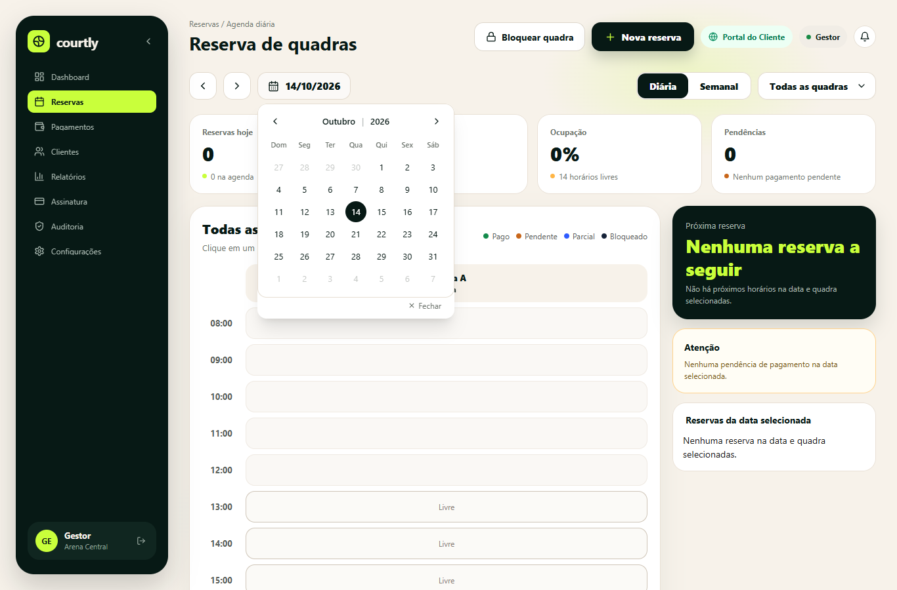
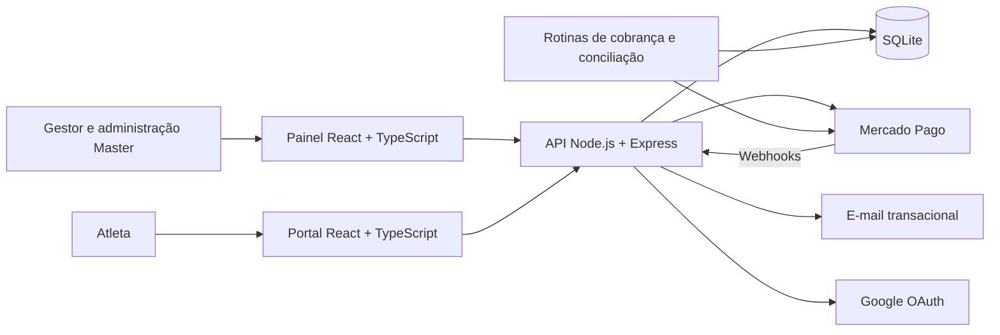

# Arenix · Gestão de arenas esportivas

**Reservas, pagamentos e operação de múltiplas arenas em uma plataforma SaaS.**

O Arenix centraliza a gestão de quadras de beach tennis, vôlei de praia e futevôlei. Conecta a jornada do atleta — consultar disponibilidade e reservar — à rotina do gestor, que acompanha agenda, clientes e recebimentos, e à administração das assinaturas da plataforma.

[Produto](#o-produto) · [Minha contribuição](#minha-contribuição-e-uso-de-ia) · [Arquitetura](#arquitetura) · [Execução local](#executar-localmente) · [Qualidade](#qualidade-e-evidências) · [Documentação](#documentação)



*Registro da interface durante o desenvolvimento, ainda com a identidade visual Courtly. Arenix é o nome deste projeto. Os indicadores da captura não representam resultados comerciais.*

## O problema

Uma reserva envolve verificar disponibilidade, respeitar o funcionamento da quadra, calcular o preço, acompanhar o pagamento e tratar cancelamentos. Quando essas informações ficam dispersas, o gestor precisa conferir manualmente a relação entre agenda e recebimentos.

O Arenix reúne esse fluxo e acrescenta a operação de um SaaS: cada arena possui seu contexto de dados, enquanto a administração central acompanha planos, assinaturas e cobranças da plataforma.

## O produto

| Experiência | Recursos presentes no projeto |
| --- | --- |
| **Portal do atleta** | Consulta de arenas e horários, fluxo de reserva, autenticação e pagamento via Pix |
| **Painel do gestor** | Agenda, quadras, bloqueios de horários, clientes, pagamentos, relatórios e assinatura |
| **Administração Master** | Gestão de arenas, planos, faturamento SaaS, usuários, comunicação e auditoria |

### Fluxos principais

- **Reservas:** validação de horários, conflitos, bloqueios, preços e fuso horário da arena.
- **Pagamentos:** integração com Mercado Pago, intenções de pagamento, processamento de webhooks e tratamento de estornos.
- **Conciliação:** revisão periódica de pagamentos pendentes ou com resultado incerto, incluindo situações sem referência do provedor.
- **Assinaturas:** cobrança da plataforma, mudanças de plano e tratamento de inadimplência.
- **Acesso e rastreabilidade:** permissões, sessões, recuperação de acesso e registros de auditoria.

## Decisões de engenharia

| Desafio | Abordagem | Evidência no código |
| --- | --- | --- |
| Operar várias arenas | Consultas e validações vinculadas ao contexto da arena | [Serviço de reservas](backend/src/services/bookingService.js) |
| Impedir reservas inválidas | Verificação de funcionamento, sobreposição, bloqueios e preço no backend | [Testes de reservas](backend/tests/reservas.test.js) |
| Lidar com respostas incertas do provedor | Estados de pagamento e rotinas de conciliação | [Intenções de pagamento](backend/src/services/paymentIntentService.js) e [conciliação](backend/src/jobs/reconciliacaoOutbox.js) |
| Manter consistência financeira | Serviços dedicados ao registro financeiro e à liquidação | [Ledger](backend/src/services/paymentLedgerService.js) e [testes do ciclo financeiro](backend/tests/payment_lifecycle.test.js) |
| Proteger credenciais de integrações | Criptografia AES-256-GCM e suporte à rotação de chaves | [Proteção de segredos](backend/src/utils/secretEncryption.js) |
| Verificar comportamentos críticos | Testes de API, componentes, navegador e regressões de segurança | [Testes do backend](backend/tests) e [validação integrada](scripts/validate.cjs) |

Esses pontos permitem explorar situações concretas: uma reserva concorrente, um pagamento pendente, uma notificação repetida ou uma operação solicitada por um usuário sem permissão.

## Minha contribuição e uso de IA

No Arenix, usei IA como apoio para transformar requisitos de gestão esportiva em uma aplicação com reservas, pagamentos e administração de múltiplas arenas. Minha contribuição envolveu definir comportamentos do produto, orientar a implementação, avaliar as entregas e conduzir revisões dos fluxos.

- **Construção:** organizar problemas em etapas de interface, API, persistência e regras de negócio, usando IA como apoio ao desenvolvimento e à investigação de falhas.
- **Decisões:** conferir as soluções propostas contra o comportamento esperado do produto, especialmente em reservas, cobranças e permissões.
- **Validação:** apoiar a revisão em testes automatizados, conferências de interface e registros técnicos, distinguindo implementação local de homologação externa.

Um exemplo é o fluxo de pagamentos: uma reserva criada não significa pagamento confirmado, e uma resposta incerta do provedor exige conciliação. Esse caso conecta uma necessidade do gestor a decisões de software e cenários verificáveis no repositório.

[Leia o estudo de caso: construção com IA, pagamentos e evidências](docs/desenvolvimento/construcao-com-ia.md).

## Arquitetura



O backend organiza rotas, middlewares, controllers e serviços de domínio. Duas aplicações frontend atendem o painel administrativo e o portal do atleta.

**Persistência:** SQLite simplifica a execução local. Na implantação, banco e uploads precisam de armazenamento persistente e backup. A arquitetura atual não deve ser apresentada como uma implantação distribuída com múltiplas réplicas independentes.

| Camada | Tecnologias |
| --- | --- |
| Interfaces | React, TypeScript, Vite e Tailwind CSS |
| API e rotinas | Node.js, Express e node-cron |
| Dados | SQLite e migrações SQL |
| Autenticação e proteção | Sessões por cookies, CSRF, bcrypt, Helmet, limitação de requisições e criptografia de credenciais |
| Integrações | Mercado Pago, Google OAuth e SMTP |
| Verificação | Vitest, Testing Library, Supertest, Playwright, ESLint e TypeScript |
| Análise estática | Configuração de SonarCloud via GitHub Actions |

```text
backend/
  src/
    controllers/       Entrada e resposta das operações
    services/          Regras de negócio
    middlewares/       Autenticação, permissões e proteção
    jobs/              Cobrança e conciliação
    config/            Banco, migrações e ambiente
  tests/               Testes de API, domínio e segurança
frontend/              Painel do gestor e administração Master
tela cliente/          Portal do atleta
docs/                  Requisitos, arquitetura e homologação
scripts/               Validação e ferramentas de desenvolvimento
deploy/                Modelos de implantação
artifacts/             Capturas e registros de verificações
```

## Executar localmente

### 1. Instalar as dependências

Utilize Node.js 22.12 ou superior compatível com as dependências e npm. Os comandos abaixo partem da raiz do repositório.

```bash
git clone https://github.com/Felipecoder07/Arenix.git
cd Arenix
npm ci
npm ci --prefix backend
npm ci --prefix frontend
npm ci --prefix "tela cliente"
```

### 2. Configurar o backend

Para uma **instalação local nova**, crie `backend/.env` com o conteúdo abaixo. Substitua os dois marcadores por valores aleatórios diferentes, gerados com o comando indicado a seguir.

```dotenv
NODE_ENV=development
PORT=3000
LISTEN_HOST=127.0.0.1
FRONTEND_URL=http://localhost:5173
CORS_ALLOWED_ORIGINS=http://localhost:5173,http://localhost:5176
APP_TIMEZONE=America/Sao_Paulo
JWT_SECRET=SUBSTITUA_POR_64_CARACTERES_HEXADECIMAIS
SECRETS_ACTIVE_KEY_ID=local-dev
SECRETS_KEYRING={"local-dev":"SUBSTITUA_POR_OUTROS_64_CARACTERES_HEXADECIMAIS"}
ENABLE_PUBLIC_BOOKING_CARD=false
```

Execute duas vezes e use um resultado para cada segredo:

```bash
node -e "console.log(require('crypto').randomBytes(32).toString('hex'))"
```

Não substitua as chaves de uma instalação existente: elas são necessárias para ler as credenciais já cifradas. Não versione o `.env`.

O arquivo [backend/.env.example](backend/.env.example) documenta opções adicionais de produção, SMTP e OAuth. Ele contém caminhos e valores ilustrativos de produção e precisa de adaptação. Configure credenciais externas apenas para os fluxos que for testar; sem elas, pagamentos, e-mails e login social não ficam disponíveis. Simulações financeiras são restritas a `NODE_ENV=test`.

### 3. Iniciar as aplicações

```bash
npm run dev
```

| Serviço | Endereço local padrão |
| --- | --- |
| Painel e página inicial | http://localhost:5173 |
| Portal do atleta | http://localhost:5176 |
| API | http://localhost:3000/api/health |

O comando inicia os três processos. Os frontends encaminham `/api` e `/uploads` ao backend pelo proxy do Vite. O servidor inicializa o esquema do banco; dados persistentes ficam, por padrão, em `backend/data` e uploads em `backend/uploads`.

### 4. Criar o primeiro administrador Master

Em uma base nova, acrescente ao `backend/.env` um e-mail sob seu controle e uma senha exclusiva de pelo menos 12 caracteres:

```dotenv
BOOTSTRAP_MASTER_EMAIL=seu-email@exemplo.com
BOOTSTRAP_MASTER_PASSWORD=SUBSTITUA_POR_UMA_SENHA_EXCLUSIVA
```

Execute em outro terminal:

```bash
cd backend
node scripts/bootstrap_master.cjs
```

Acesse `http://localhost:5173/master-login`. O bootstrap preserva um administrador Master já existente. Não há credencial pública compartilhada para esse acesso.

> No PowerShell, caso a política de execução bloqueie `npm.ps1`, use `npm.cmd` no lugar de `npm`.

## Qualidade e evidências

Na raiz do projeto:

```bash
# Testes das três aplicações
npm test

# Testes, tipos, builds, lint e inspeção dos arquivos públicos
npm run validate

# Verificações direcionadas do gateway de pagamentos
npm run validate:gateway
```

A validação integrada executa **10 etapas** e gera logs e um `summary.json` em `artifacts/homologacao/`, com identificação do commit e resultado de cada etapa.

A [revisão registrada em 08/10/2026](docs/historico/REVISAO_FINAL_2026-10-08.md) documenta **579 testes aprovados**: 450 no backend, 98 no painel e 31 no portal. Esse número descreve aquela execução; para verificar o estado atual, execute a validação novamente.

Os cenários incluem reservas, autorização, isolamento entre arenas, concorrência, pagamentos, estornos e regressões de segurança. A aprovação automatizada é uma evidência técnica; a homologação das integrações e do ambiente de produção é uma etapa separada.

## Roteiro de demonstração

Uma apresentação curta pode acompanhar uma única jornada:

1. **Disponibilidade:** apresentar a agenda de uma arena e seus horários livres ou bloqueados.
2. **Reserva:** percorrer o fluxo do atleta e explicar as validações feitas pelo backend.
3. **Operação:** mostrar como o gestor acompanha reservas e situação financeira.
4. **Confiabilidade:** explicar o tratamento de um pagamento pendente e abrir o teste correspondente.
5. **SaaS:** apresentar a separação entre gestão da arena e administração da plataforma.

Use uma base de demonstração identificada como teste. Para demonstrar confirmação de pagamento, configure e homologue o ambiente do provedor; indicadores de uma base de testes não representam faturamento ou adoção real.

## Estado e próximos passos

O repositório contém implementação, testes e registros de verificações locais. Disponibilidade pública, adoção por clientes e homologação de pagamentos reais não são comprovadas por este README.

As próximas etapas de entrega incluem validar integrações no ambiente de destino, conferir persistência e restauração de backups e registrar evidências atualizadas da jornada completa. O acompanhamento técnico está no [guia de homologação](docs/qualidade/HOMOLOGACAO.md).

## Documentação

| Documento | Conteúdo |
| --- | --- |
| [Requisitos do produto](docs/produto/CourtManager_PRD.md) | Contexto, funcionalidades e escopo |
| [Inventário funcional](docs/historico/INVENTARIO_FUNCIONAL_2026-09-22.md) | Levantamento dos fluxos do sistema |
| [Mapa de arquitetura](docs/arquitetura/architecture_map.html) | Visualização interativa; abra localmente no navegador |
| [Regras de pagamentos](docs/produto/regras_pagamentos.md) | Comportamentos do domínio financeiro |
| [Testes de ponta a ponta](docs/qualidade/functional-e2e.md) | Fluxos e verificação funcional |
| [Homologação](docs/qualidade/HOMOLOGACAO.md) | Critérios e evidências para entrega |
| [Checklist de implantação](docs/operacao/DEPLOYMENT_CHECKLIST.md) | Preparação do ambiente |
| [Google OAuth](docs/operacao/configuracao_google_oauth.md) | Configuração do login social |
| [Mercado Pago OAuth](docs/operacao/configuracao_mercado_pago_oauth.md) | Configuração da integração |

---

Projeto no portfólio de [Felipe · Felipecoder07](https://github.com/Felipecoder07).
